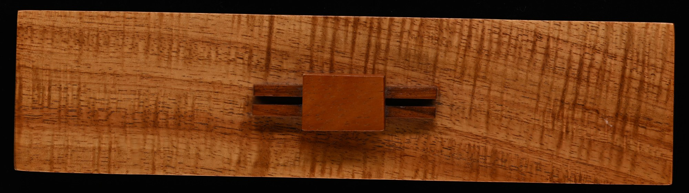
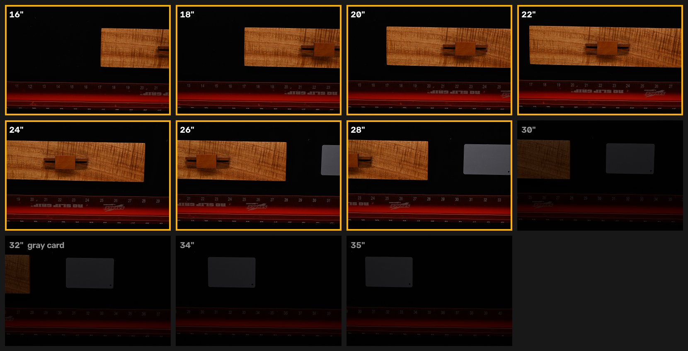
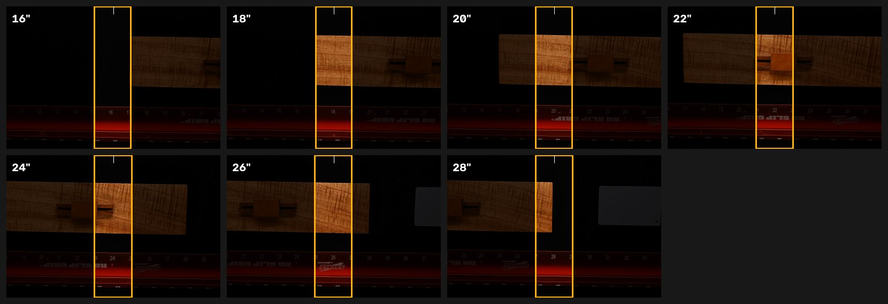
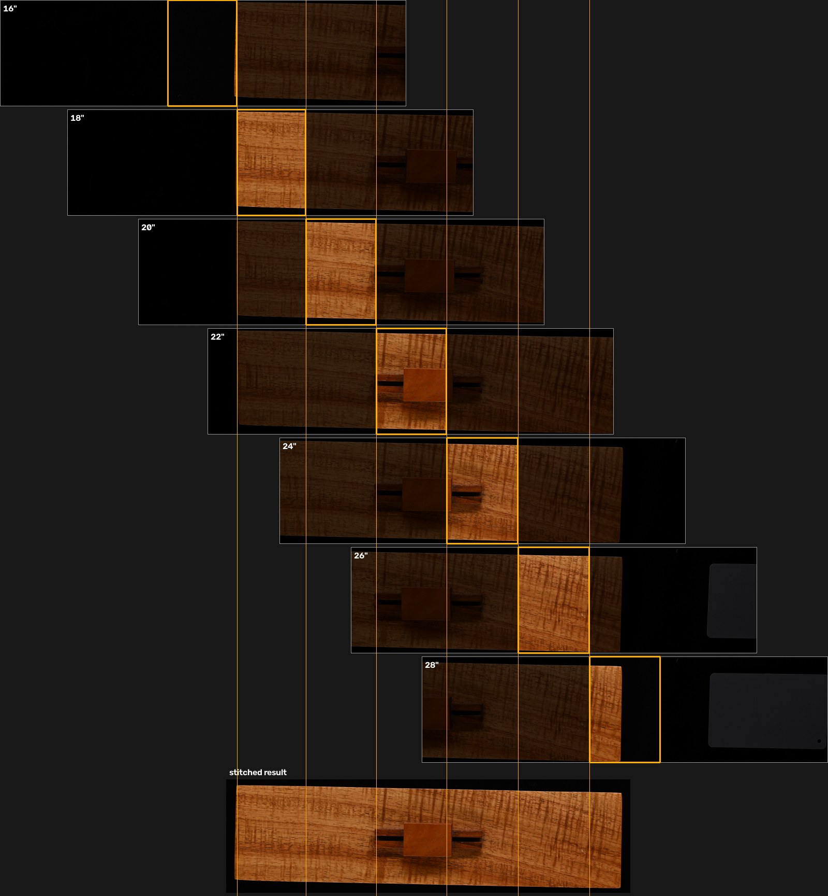
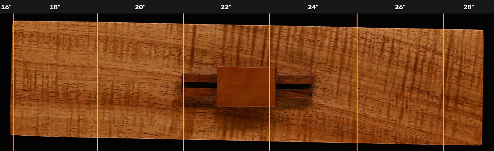
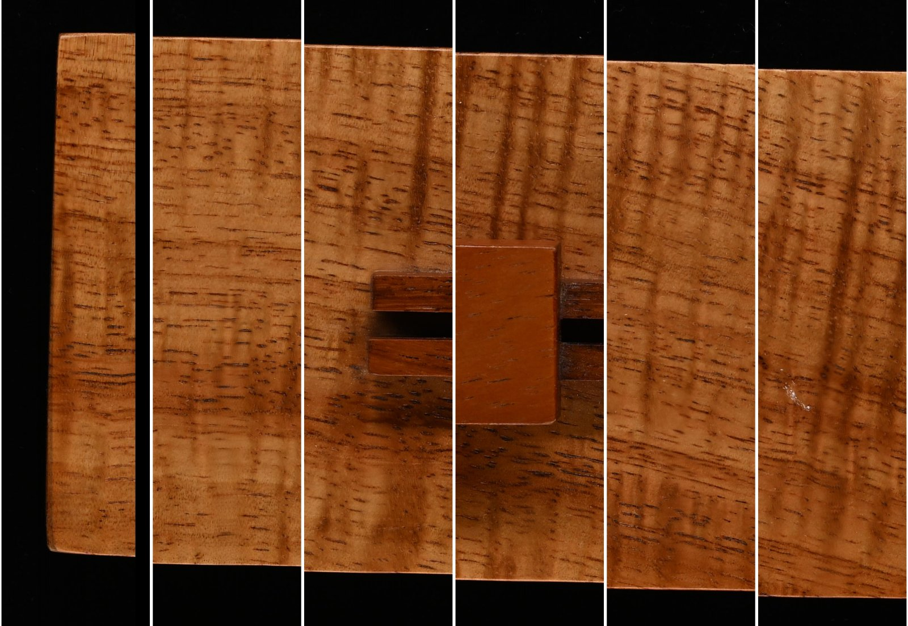

# SwordPhotography

Overlapping top-down photo scans of long objects (sword boxes, blades) on a motorized
edelkrone slider, with a Nikon camera triggered over MCP, stitched from the centre of each
frame into one evenly lit, low-distortion image.

[](docs/images/box_top_full.jpg)

*Wooden box top, stitched from 7 frames. Click for the full-resolution image
([`box_top_full.jpg`](docs/images/box_top_full.jpg), 6020 × 1687 px, about 11.4" × 3.2",
529 px per inch).*

## From scan to stitched image

This is the test run from 2026-10-25, before switching to a longer lens: shots every 2"
from 16" to 35" on the ruler, camera focus, aperture, shutter and white balance (5600K)
locked.

### 1. The scan

The slider moves the bed under the camera and stops every 2"; the camera takes one frame
per stop. Each frame shows about 12" of ruler, so neighbouring frames overlap by about
10". The seven frames that cover the box (outlined) were stitched; the last four frames
are the gray card, used for colour checks.



### 2. One strip from the centre of each frame

The centre of a frame has the least lens distortion, vignetting and perspective, so only
a strip around each frame's centre column is used. The strip width equals the interval
between shots (here ±1"), so the strips tile with no gaps. The tick at the top marks
the frame centre; note the ruler under each strip reads the frame's own position.



### 3. How the frames overlap and become the final image

Each frame is placed where it matches its neighbours, measured on the wood grain itself
rather than the ruler: the box top sits above the bed, so it's magnified about 5% more
than the ruler (529 vs 505 px per inch). Below, every frame is drawn at its measured
position: dimmed where it isn't used, lit inside its strip. The seam lines run straight
down into the stitched result. The small vertical step between frames is the slider
rail running about 1.7° off the camera's horizontal, which the matching corrects.



### 4. The result, seam by seam

The stitched image with each seam marked and the frame each strip came from:



Full-resolution crops centred on each seam (the seam runs down the middle of each
panel): grain, edges and the inlay run straight through. Neighbouring strips are
cross-faded over ¼".



These images are built from each frame's embedded JPEG preview and regenerated with
[`tools/make_readme_images.py`](tools/make_readme_images.py). The stitch itself is
[`stitch.py`](stitch.py); see [docs/INSTRUCTIONS.md](docs/INSTRUCTIONS.md#6-stitching-a-run).

## What's here

| File | What it does |
|---|---|
| [`.claude/skills/create-run`](.claude/skills/create-run/SKILL.md) | Claude Code skill: say **"Create a run"** and it asks for the API key (once), checks calibration on the first run, asks start/stop/interval with last run's answers as defaults, and starts the scan |
| [`.claude/skills/stitch-run`](.claude/skills/stitch-run/SKILL.md) | Claude Code skill: say **"Stitch a run"** and it picks the run (newest by default), asks the range and blend, stitches, checks the seams and reports |
| [`stitch.py`](stitch.py) | Stitches a run's centre strips into one image, using the run's own interval; registers frames on the object itself |
| [`run_config.py`](run_config.py) | Helper for the skill: stores the token, remembers answers, checks a plan, reads slider status, stores rail ends |
| [`slider_scan.py`](slider_scan.py) | The scan: moves to each ruler position, settles, captures, files the shot into the run folder, logs |
| [`slider_goto.py`](slider_goto.py) | Moves the slider to a `slide_cm` position (e.g. the centre) |
| [`xbox_slider.py`](xbox_slider.py) | Drive the slider by hand with an Xbox controller's left stick |
| [`nikon.py`](nikon.py) | Nikon MCP client (`capture`) and NEF preview-JPEG extractor (`preview`) |
| [`tools/controller_probe.py`](tools/controller_probe.py) | Diagnoses the Xbox controller: XInput vs raw HID |
| [`tools/make_readme_images.py`](tools/make_readme_images.py) | Makes the README's images from a run and its stitch report |
| [`docs/images/`](docs/images/) | The README's images, including the full-resolution box top |
| [`docs/INSTRUCTIONS.md`](docs/INSTRUCTIONS.md) | Step-by-step: setup, calibration, running a scan |
| [`docs/HOW_IT_WORKS.md`](docs/HOW_IT_WORKS.md) | Design notes and everything learned getting it working |
| [`docs/slider_positions.md`](docs/slider_positions.md) | Measured slider travel and positions |
| [`docs/example_scan_log.csv`](docs/example_scan_log.csv) | The log from the first scan |

## Quick start

In Claude Code, opened in this folder, say **"Create a run"**.

Or by hand:

```powershell
pip install -r requirements.txt
'<token from the Nikon MCP server>' | python run_config.py set-token   # once
python slider_scan.py 16 35 2    # 16" to 35", one shot every 2"
```

Read [docs/INSTRUCTIONS.md](docs/INSTRUCTIONS.md) first: the ruler calibration in
`slider_scan.py` is only valid for the rig as it was set up, and the slider must be
checked after a power cycle.

## Hardware

- edelkrone **SliderPLUS v5 PRO / Long** with the **Motor Module for SliderPLUS**
  (reports over Bluetooth as `Motor Module V3`, MAC `C4:DE:E2:EA:5A:E8`, firmware 0.46)
- Nikon camera facing straight down, controlled by the **ArcEngineNet10 MCP** server
  (NikonMCP module) on `http://127.0.0.1:<port>/mcp`; the camera saves `c:\images\NNNN.nef`,
  and each scan moves its shots into a run folder `c:\images\yyyy-mm-ddThh-mm-ss\0.nef, 1.nef, ...`
  (see [Run folders and file naming](docs/INSTRUCTIONS.md#run-folders-and-file-naming))
- Xbox Wireless Controller (Xbox One S, Bluetooth, PID `02E0`)
- Black velvet bed, a SAVAGE aluminum ruler along the bottom edge, a gray card
- Windows 11, Python 3.15, edelkrone SDK 0.1.1

## Safety

Every script stops the slider in a `finally` block before disconnecting. Stop any motion
with **Ctrl+C** or the **stop button on the slider**; in `xbox_slider.py`, also **B**.
Keep the rail path clear of people, cables and objects.
